# Social Relationship Lab

**開くファイルは `Social_Relationship_Lab.toe` の一つだけです。**

[正式版をダウンロード](https://github.com/maton369/social-relationship-lab/releases/latest/download/Social_Relationship_Lab.toe) → 書き込み可能なフォルダに保存 → TouchDesignerで開いてください。

コードとWindows x64／Mac Apple Silicon用の対応ライブラリを同梱しています。サメのプロジェクト、別のTOX、Pythonの追加インストール、MCP、pip設定は不要です。TouchDesigner本体とライセンス登録は必要です。

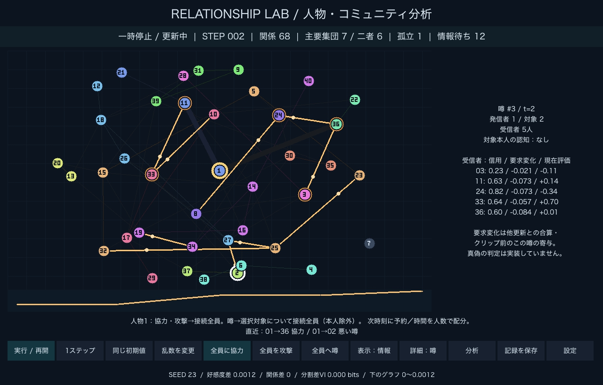

## 講義での5分発表

[発表用PDF](presentation/Social_Relationship_Lab.pdf)・[編集用PowerPoint](presentation/Social_Relationship_Lab.pptx)・[読み上げ原稿とデモ操作](presentation/speaker-notes.md)を用意しました。本編8枚で5分、仕様・検証・参考文献の補足は後ろの5枚です。

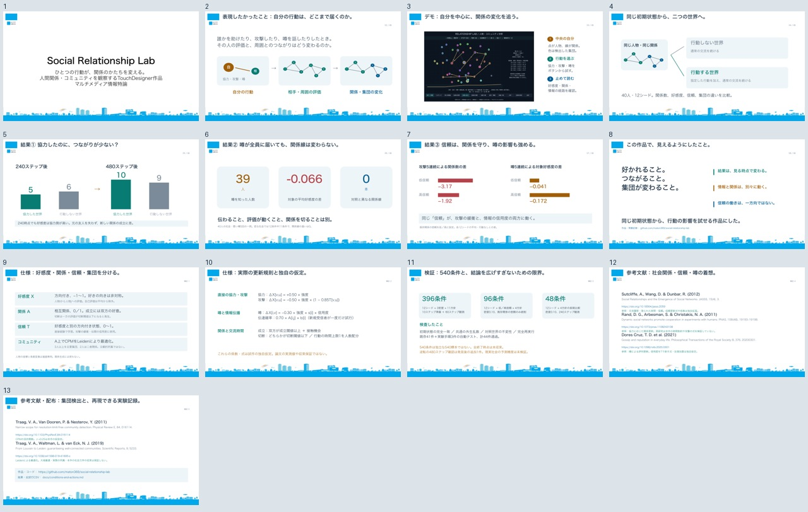

## 交流の履歴・時間制約・自律交流

TouchDesignerの初期モードを**自律交流あり**にしました。「設定」→「Social Dynamics」で基準（比較用）／履歴・信頼／履歴＋時間制約／自律交流ありを選択し、「同じ初期値」で適用します。

- 好感度とは別の信頼を蓄積し、強い関係は一度の攻撃で切れにくくします。繰り返し攻撃すれば信頼が下がり、切れる場合があります。
- 全員への行動に使える時間を固定し、人数で配分します。人数が多いほど一人当たりの効果が薄まります。
- 各人物も相手を選んで交流を申し込み、受諾・拒絶・時間不足を記録します。既存関係以外にも交流する機会があります。
- 「詳細：交流」で信頼・実際の交流経験・時間残量を確認できます。噂のボタンを押すと「詳細：噂」と情報表示に切り替わり、誰が聞き、どれほど評価を変える要求が生じたかを確認できます。

式と全パラメータ：[モデル設計・更新順序](docs/social-dynamics.md)。出典と独自仮定の区別：[参考文献](docs/references.md)。

私たちのソフトウェア内の仮定を観察するためのモデルです。実在の人間の行動を予測する精度を検証したものではありません。

## 実施・保存した検証

**初期条件と行動方針を変えた540条件の比較**を追加しました。[実験結果と、このモデル内での行動の選び方](docs/conditions-and-actions.md)に、関係密度・信頼・協力する相手と頻度・攻撃・噂の違い、全試行のCSV、再現コマンドをまとめています。540条件は12シードの対応比較であり、現実の対人関係への処方ではありません。

好感度が上がっても関係数が増えない例、39人に噂が届いても関係線が変わらない例、240ステップと480ステップで評価が逆転する例を確認しました。否定的・無変化の結果も保存しています。今回の実験でアプリの更新式や正式TOEは変更していません。

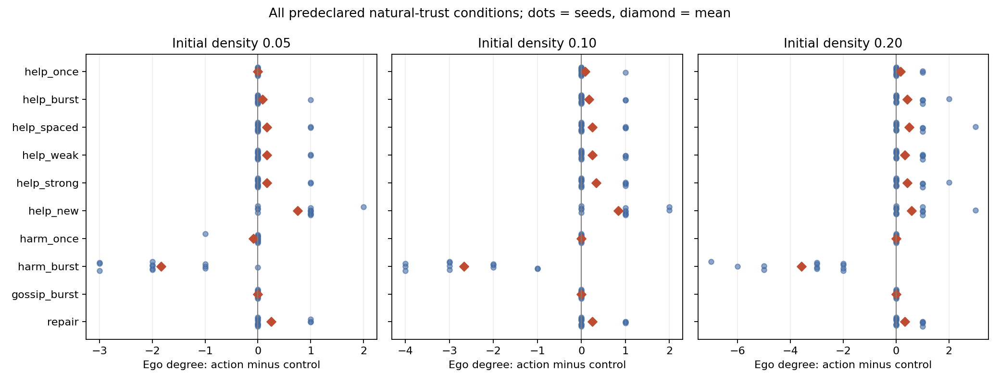

[単発介入36条件の結果](docs/experiments/social_dynamics/results.md)と、[10回反復した追加9条件](docs/experiments/social_dynamics/repeated/results.md)を保存しました。シード23・30・42を共通に使い、行動あり／なしは介入前まで完全一致することを検査しています。変化しなかった結果も含みます。

[機能追加時の実操作ログ](docs/experiments/social_dynamics/ui_checks.json)には、12条件のボタン操作と出力の確認を記録しています。当時の自動テストは40件通過しました。単一ファイル配布に統一した正式版では、[ソースのないフォルダでの起動と41件のテスト](docs/official-release-checks.json)を別途確認しています。過去のログは、その時点の検証証拠として保存しています。

全条件のCSV、実行条件・ソースハッシュ、再現確認、選択した試行の全時刻状態と履歴（圧縮JSON）は `docs/experiments/social_dynamics/` にあります。3シードの記述的な比較であり、統計的な一般則を示す検証ではありません。

| 交流履歴・残り時間の実画面 | 噂の到達先と評価変化の実画面 |
| --- | --- |
| 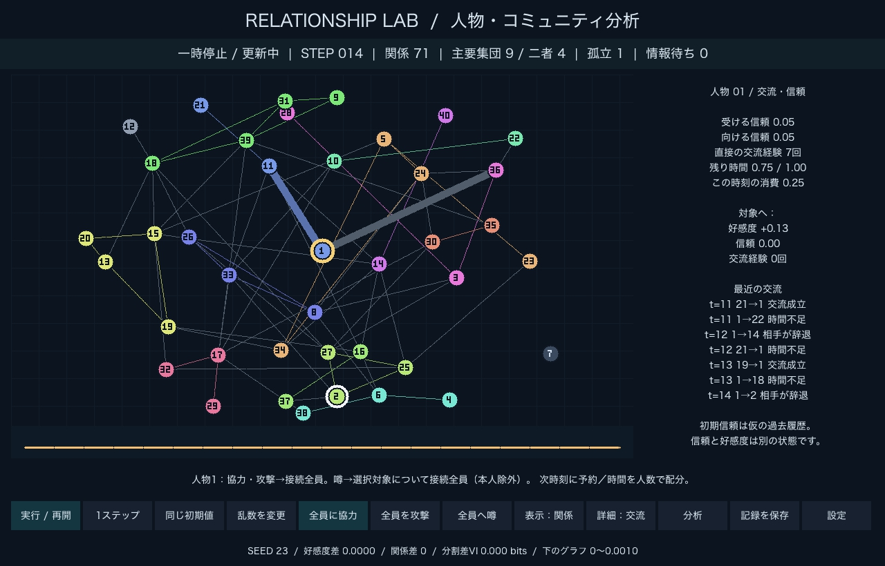 | 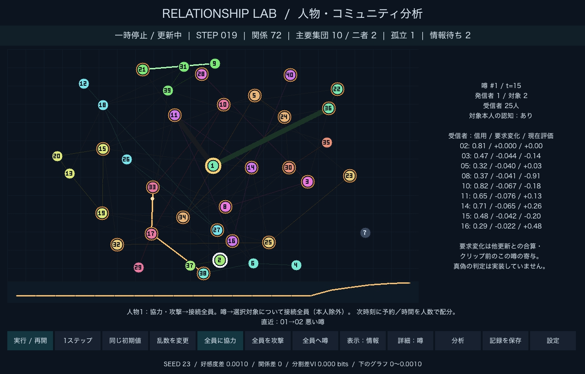 |

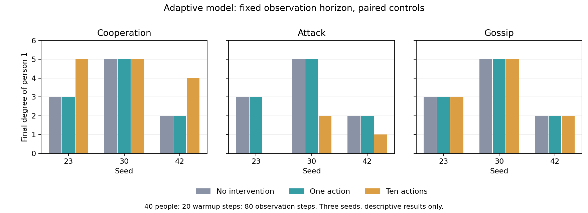

確認の経緯・問題の修正・具体的な数値：[検証記録](docs/experiments/social_dynamics/verification-notes.md)。実時間の開始・停止は別途、内部タイマーから実際のボタンを操作して確認し、STEP 7→14へ進んで停止しました。画面の実時間進行と同じ操作をヘッドレスで再現したところ、両世界のX/A/信頼が完全一致しました。

## 手動での停止・再開

**画面で実行した場合は、安定判定や100ステップ到達で自動停止しません。** 「一時停止」で任意の時点に止め、「実行 / 再開」で同じ状態から続けられます。「1ステップ」は停止中に一回だけ進めます。停止時に現在の人物・コミュニティ分析を計算します。「分析」ボタンからも停止と分析ができます。

上部の「実行中／一時停止」は操作状態、「観測上の安定／停止状態を確認」などはモデルの観測結果です。モデルが安定していても、実行操作は継続します。設定のLimitは単体Pythonでのバッチ計算用で、画面操作の上限には使いません。

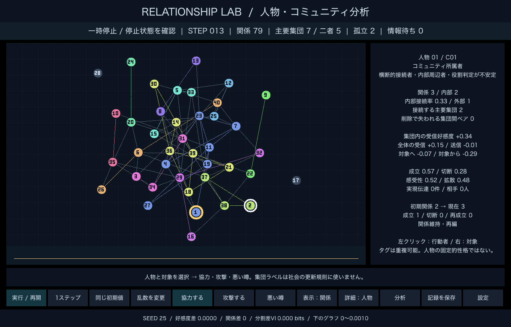

## ネットワーク上の自分ノード

選択中の行動者をネットワーク図の中央に固定します。周囲の人物は魚眼レンズのような放射変換で、中心付近を広げ、表示領域の端を保つように配置します。これは表示専用の変換で、社会関係やシミュレーション状態には影響しません。

中央の人物へ直接つながる関係線は11ピクセル、その他の通常の関係線は1ピクセルで描画します。行動者を選び直すと、太く表示する線も切り替わります。好感度・情報・比較表示でも中央の人物の線を強調します。

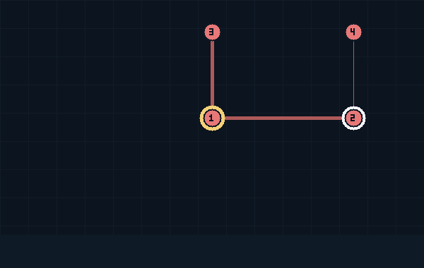

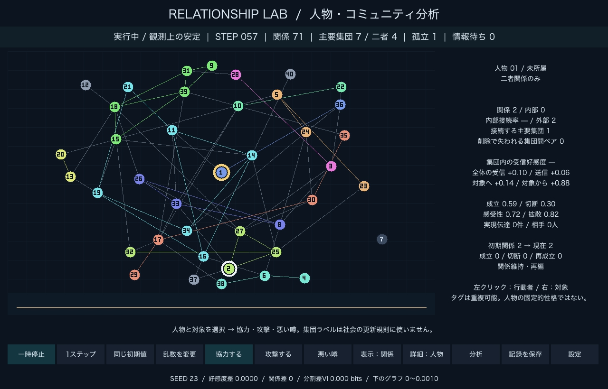

## 実画面

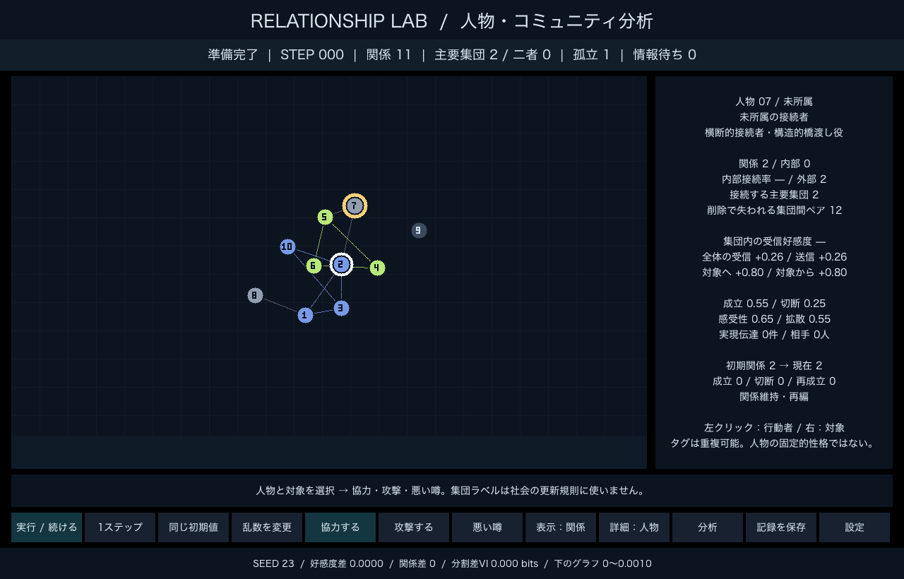

| 行動なし／ありの人物比較 | 役割ごとの属性分布 |
| --- | --- |
| 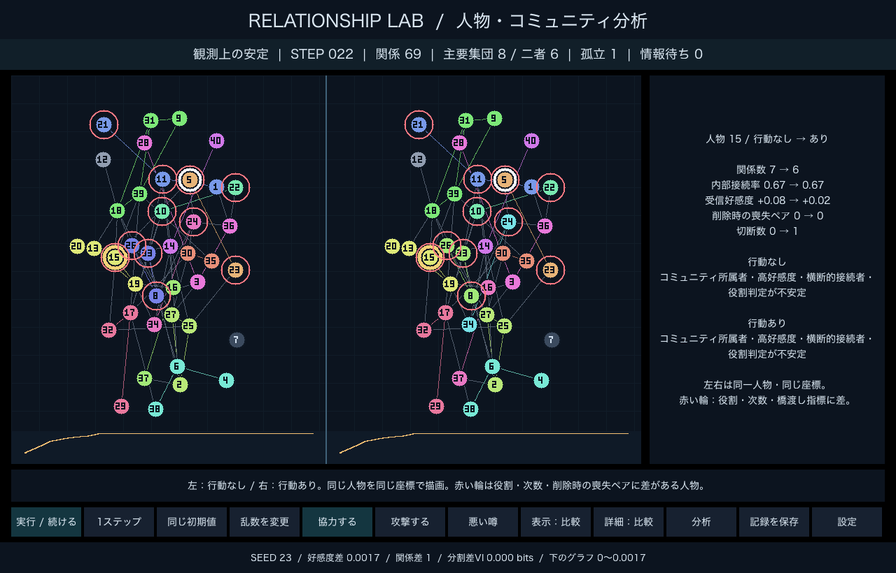 | 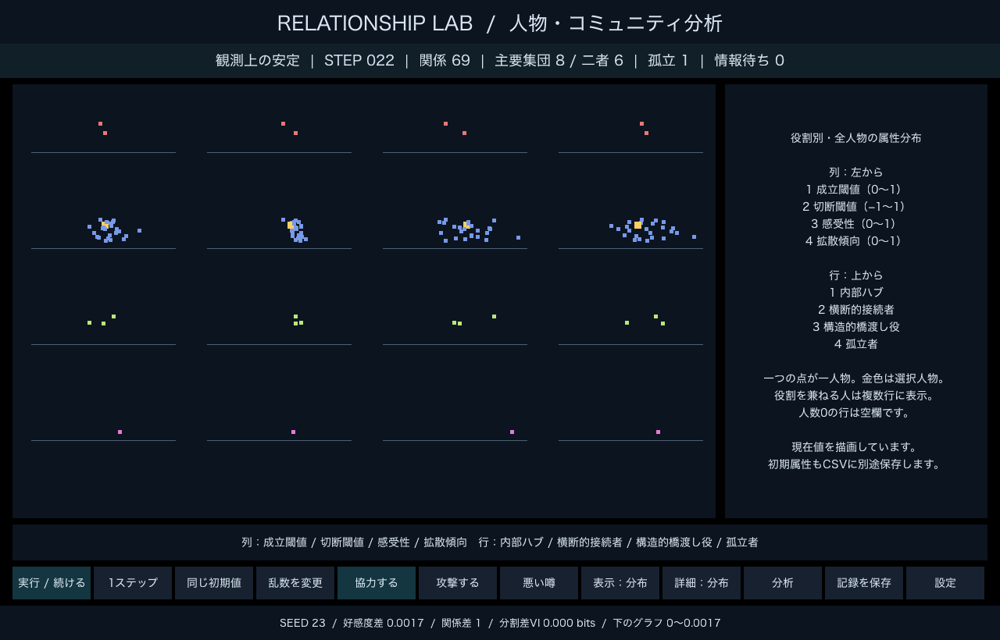 |

| ランダムな初期状態 | 人物の履歴 |
| --- | --- |
| 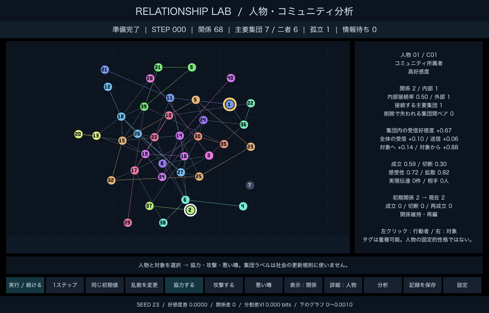 | 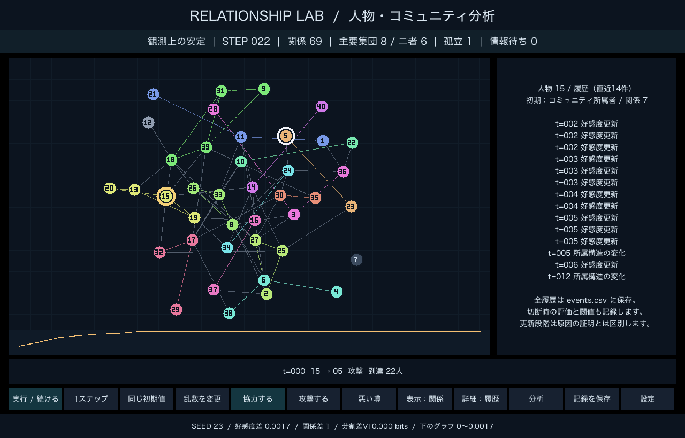 |

画像はTouchDesignerのパネルから直接保存しました。10人の例だけは定義を検証するために指定したグラフです。通常の初期化は40人のランダムグラフで、集団を予め埋め込んでいません。

## 利用方法

1. TouchDesigner 2025（Python 3.11を搭載した版）をインストールし、初回のライセンス登録を済ませます。
2. **`Social_Relationship_Lab.toe` だけ**を、ダウンロードフォルダなど書き込み可能な場所へ保存します。
3. このファイルを開くと、初回だけ同じ場所の `.social_lab` フォルダへコードと対応ライブラリを展開し、操作画面を開きます。通常はインターネット接続不要です。

`.social_lab` は自動生成する動作用フォルダです。別のメンバーへ渡すのは `.toe` 一つだけで構いません。「記録を保存」の出力先は `.toe` と同じ場所の `exports/` です。メンバーが複数版から選択する必要はありません。

対応は **Mac Apple Silicon／Windows x64、Python 3.11版のTouchDesigner**。Mac実機での確認結果は [正式版の検証記録](docs/official-release-checks.json) に保存します。Windows用バイナリも内蔵していますが、Windows実機での描画は未確認です。

## Windows：コマンドプロンプトから開く場合

`.toe` をTouchDesignerで開けば起動できます。コマンドプロンプトを使う場合は、任意で [start_windows.cmd](start_windows.cmd) も同じフォルダへ保存して実行します。

```bat
start_windows.cmd
```

TouchDesignerが標準以外の場所にある場合：

```bat
set "TD_EXE=D:\Apps\TouchDesigner\bin\TouchDesigner.exe"
start_windows.cmd
```

このコマンドも同じ正式版 `.toe` を開きます。旧版向けの環境構築スクリプトや、別の起動用TOEは配布していません。

## 操作

**人物1の行動は接続中の全員が対象です。** 「全員に協力」「全員を攻撃」はボタンを押す直前の関係グラフから相手を固定します。旧モデル・履歴モードは各人へ指定の強さで即時に適用します。時間制約・自律交流モードは次の時刻に予約し、同じ時刻の時間予算を人数で配分します。好感度の変化は同じ旧状態から計算して合算し、最後に一度だけクリップ・関係更新します。各相手への行動は個別のイベントIDと共通の `batch_id` で記録します。対照世界へ指定した行動を入れません。接続相手がいない場合は行動を発生させず通知します。

人物1の「全員へ噂」は、右クリックで選択した1人を**噂の対象**とし、接続中の全員を**直接の受信者**とします（対象本人を除く）。この一度の噂を受信者全員が知り、その後は通常の伝播規則で広がります。噂を話すことで対象本人との接触機会は作りません。人物2以降を行動者にした場合は、従来どおり選択した相手への単一行動です。この画面上の対象選択規則は作品独自の設定で、論文由来の式ではありません。モデル出力の `model_version` は `3.0`、スナップショット形式の `version` は `3` です。

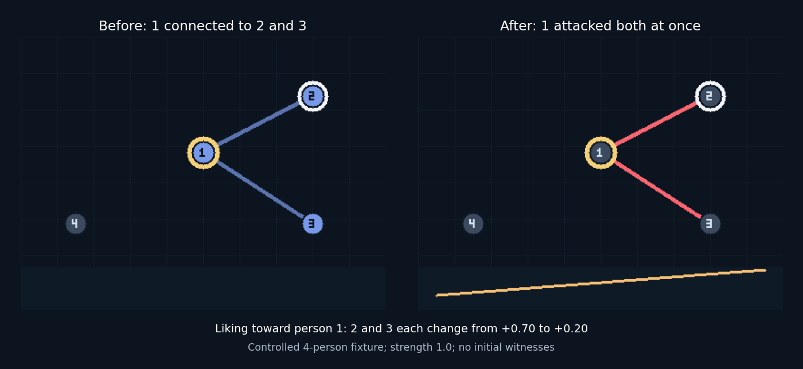

1. 人物を左クリックして行動者、右クリックして対象を選びます。金色の輪が行動者、白い輪が対象です。
2. 行動ボタンは一度だけ行動を発生させ、その後を自動更新します。人物1の場合は上記の全接続者への行動になります。
3. 「実行 / 再開」と「一時停止」で進行を操作、「1ステップ」で手動更新します。
4. 「表示」は **関係 → 好感度 → 情報 → 行動なし／あり比較 → 属性分布** を循環します。
5. 「詳細」は **人物 → 集団 → 全体分析 → 人物比較 → 履歴 → 分布の凡例** を循環します。比較と分布では対応するグラフ表示にも切り替えます。
6. 「分析」は現在の状態を分析し、一時停止します。「一時停止」を押した時にも分析を計算します。「記録を保存」でCSV群とJSONを保存します。

「設定」のSimulationページで人数・シード・対象・行動の強さ・選択人物の成立閾値／切断閾値／感受性／拡散傾向を変更できます。切断閾値は成立閾値未満でなければ変更を拒否します。Modelページでは接触・伝達・行動の係数を操作できます。

人数、シード、初期密度、Analysisページの**役割判定条件は「同じ初期値」で反映**します。役割の閾値だけを途中で変更して、同じ試行中の役割を付け替えることはしません。「同じ初期値」は人物編集も初期分布へ戻します。「乱数を変更」はシードを1増やします。

人物属性と社会モデル係数を途中で変更した場合は比較系にも同じ変更を適用し、ログに記録します。CPMのγだけの変更は測定方法の変更として扱い、X/Aは変えず、社会的な分裂・合流イベントを生成しません。

## 基本状態と役割タグ

CPMの全分割を保持した上で、最小人数3以上のブロックだけを「主要コミュニティ候補」とします。人数だけで実在する強い集団とは認定しません。二人組はダイアドとして分離します。

| 基本状態（排他的） | 条件 |
| --- | --- |
| コミュニティ所属者 | 最小人数以上のCPMブロックに所属 |
| 二者関係のみ | CPMの二人組に所属。外部の関係を持つ場合もある |
| 未所属の接続者 | 主要集団にも二人組にも属さず、実際の関係がある |
| 孤立者 | 実際の関係が0本 |

| タグ（重複可能） | 初期の判定規則 |
| --- | --- |
| 内部ハブ | 集団人数4以上、内部次数3以上、内部接続率0.60以上、内部次数が集団中央値より大きい |
| 高好感度 | 集団内の他の全構成員からの平均好感度が0.50以上 |
| 横断的接続者 | 直接の関係を持つ主要集団が2つ以上。自分の集団も含める |
| 構造的橋渡し役 | 人物削除で、新たに到達不能になる異なる主要集団間の人物ペアが1組以上 |
| 内部周辺者 | 主要集団に所属し、内部次数がその集団の中央値未満 |

主要集団の最小人数は3〜5、ハブの最小人数・次数・接続率、高好感度の境界を設定可能です。いずれも作品の操作的な仮設定です。完全グラフでは全員の内部次数が中央値と同じなので、内部ハブを指定しません。三人組にも初期条件ではハブを指定しません。

### 二種類の橋渡し

`communities_contacted` は、直接関係を持つ主要集団の数です。一方、`brokerage_disconnected_pairs` は、人物を除去したとき、元々経路があった異なる主要集団の人物同士のうち、新たに経路を失うペア数です。除去する人物本人を含むペアは数えず、所属は除去前に固定します。迂回経路があれば0になり得ます。

提示された10人の例をγ=0.40で検証し、CPM値4.4、人物7の喪失ペア12、人物2が9、人物3が0を確認しました。人物2と3はいずれも内部ハブですが、人物2のみ構造的橋渡し役です。人物7は未所属かつ関係2本で、横断的接続者・構造的橋渡し役です。人物8は未所属で一集団への外部接続、人物9は孤立です。

### 人物・集団・全体の指標

人物について、総次数、内部次数・接続率、外部次数、接続先主要集団別の本数、削除時の喪失ペア、媒介中心性、内部次数z、全体／集団内／実際の隣人に限定した受信・送信好感度を保存します。該当しない集団内平均・接続率や分散0のzは `null` とし、0と区別します。

全体平均には関係のない人物も含めます。切られた相手からの負評価が平均から消える問題を避けるため、隣人限定の平均は別指標です。Xは好感度であり、独立した信頼行列はまだありません。「高信頼」「リーダー」「実効影響力」とは表示しません。

集団表示では構成員、人数、密度、内部次数順のハブ、喪失ペア数順の構造的橋渡し役を表示します。外部接続者は**他集団の所属者**と**主要集団に属さない人物**に分け、接続本数順に並べます。未所属の側には二者関係の人物も含まれます。

役割別集計は、内部ハブ、横断的接続者、構造的橋渡し役、孤立、高好感度、内部周辺者、所属曖昧を対象とし、人物の重複を許します。画面の属性分布には現在値を全人物の点として表示します。列は成立閾値・切断閾値・感受性・拡散、行はハブ・横断接続・構造的橋渡し・孤立です。各パネルの左→右が設定範囲、金色は選択人物です。人数0の行は空欄になります。

## 履歴と情報伝播の実績

初期属性、初期次数・所属・受信／送信好感度・内部接続率などを、現在値とは別に保持します。途中で人物属性を編集しても初期属性は上書きしません。

成立数・切断数・再成立数・失った相手、行動回数・協力／攻撃を受けた回数・初期目撃回数・情報受信数、所属構造の変化を記録します。孤立の遷移は「孤立継続」「関係獲得」「孤立化」「関係維持・再編」の四種類です。

イベントログには行動、初期目撃、伝達の試行と成否、新規受信、好感度更新、関係成立・切断、加入・離脱・所属構造の変化を保存します。好感度更新は直接効果・初期観測・情報受信を区別し、切断時は両方向の好感度と切断閾値を保存します。同期更新に複数の入力があれば合算・クリップ前の入力も記録します。更新段階の記録は、長い経路について一つの行動を唯一の原因と証明するものではありません。

拡散傾向bと実績は別です。`successful_transmissions` は新規受信時にその人物が成功情報源として含まれた件数、`unique_people_informed` はその経路で情報を知った異なる人物数です。同時の複数情報源にはそれぞれ実績を数えるため、人物別件数の合計は受信人数を超え得ます。別の `transmission_credit` は同時情報源間で1件を等分した記述的な割当です。評価更新に使う信用度は最も信用する情報源から計算し、等分割当とは別です。これらを社会的影響力の因果推定とは扱いません。

## 社会モデル・コミュニティ検出・安定判定

方向付き好感度X、無向の実際の関係A、出来事ごとの知識、観測するコミュニティを分けます。所属ラベルと画面座標は社会更新に使いません。

初期Aは密度0.10のランダムグラフ。既存関係への方向付きXは独立な一様分布 `[0.65,0.90]`、非関係者は標準偏差0.35の正規分布を `[-1,1]` に制限します。人物の成立閾値は平均0.55・標準偏差0.07、切断は0.25・0.05、感受性は0.65・0.15、拡散は0.55・0.15から生成します。範囲を制限し、初期の切断閾値は成立閾値より0.10以上低くします。この初期生成規則自体が、好感度と次数の相関を生む場合があります。

協力／攻撃は対象から行動者へのXを `±ηv×強さ` 変更します。目撃・受信した第三者から行動者への差分は `ηo×強さ×感受性×信用度×符号×((1−ω)+ωX[第三者,対象])`。悪い噂は受信者から対象へのXを `−ηr×強さ×感受性×信用度` 変更します。初期目撃者は両当事者の隣人の和集合から最大2人、噂では発信者の隣人から選びます。

新規に情報を知った人物は次の時刻に、関係のある各相手へ一度だけ伝達を試みます。成功確率は `pmax×発信者の拡散傾向`。評価変更は出来事ごと・人物ごとに一度だけ。二次情報の信用度は `(1+X[受信者,情報源])/2`、同時受信なら最大値を採用します。

各時刻は旧状態から同期計算し、差分を合算して一度クリップします。相互に成立閾値以上で接触機会があれば関係成立、一方が切断閾値以下なら切断。接触確率は `min(1,q0+qtri×共通友人の有無)`。協力／攻撃の当事者には直ちに機会を与えます。

| 主な初期値 | 値 |
| --- | --- |
| 人数 / seed | 40 / 23 |
| q0 / qtri / pmax | 0.03 / 0.10 / 0.70 |
| ηv / ηo / ηr / ω | 0.50 / 0.40 / 0.30 / 0.65 |
| CPMγ / 初期目撃者上限 / 行動強さ | 0.25 / 2 / 0.80 |
| 安定窓 / 許容値 / バッチ計算上限 | 10時刻 / 0.005 / 100時刻（画面の実行は上限なし） |

CPMの `ΣC(内部関係本数−γ|C|(|C|−1)/2)` を公開実装のLeidenで最適化します。固定6シードの良い解を比較し、同点なら前の分割を維持。同じA・γの結果はキャッシュします。探索した同点分割間で所属が変われば「所属曖昧」、基本状態または役割タグが変われば「役割判定が不安定」と表示します。発見できなかった解を含む一意性の証明ではありません。

集団IDはJaccard係数の最大重み一対一対応（0.25以上）で追跡します。二人以上の重なりを持つ一対多／多対一を分裂／合流候補とし、新しい分割が3時刻続くと確定します。本人の意思としての加入・脱退はモデル化していません。

好感度の最大差が0.005未満、A不変、ラベル名に依存しない分割が不変、という条件が**両世界で10時刻続き、未処理情報がなくなる**と安定状態を表示します。自動停止はしません。将来成立し得る未接続ペアがあれば「観測上の安定」、なければ「停止状態を確認」、Python単体で上限を適用した場合、上限まで安定しなければ「上限到達・未安定」です。外生行動や設定変更がない条件での判定です。

比較系は同じ初期状態から指定行動なしで更新します。接触の乱数はシード・時刻・人物ペア・用途に紐づけ、行動による乱数消費順の影響を避けます。比較画面は同じ人物を同じ座標で描き、役割・次数・橋渡し重要度の差を赤い輪で示します。色の番号だけでは所属の差を判断しません。

下の曲線は両世界の好感度の平均絶対差。縦軸は直近400記録の自動調整で下部に範囲を表示します。関係差は異なる無向ペア数、分割差はVI（bits）です。

「分析」では次数保存の二辺交換による39比較グラフのCPM値と比較し、変化不足なら保留とします。探索的比較で、混合・独立性の保証や集団の実在証明ではありません。γ=0.15、0.25、0.40の感度も保存します。

## 出力と再分析

`exports/seed…_t…_時刻/` に試行ごとのフォルダを作成します。

| ファイル | 内容 |
| --- | --- |
| `runs.csv` | seed、条件、行動、設定、役割閾値、分析状態、バージョン |
| `agents.csv` | 一条件・一人物ごとの基本状態、タグ、初期属性／指標、現在指標、履歴集計 |
| `agent_communities.csv` | 人物×主要集団の直接接続数・所属有無 |
| `communities.csv` | 条件別の集団・二人組、密度、構成員、外部接続者 |
| `events.csv` | 両条件の全イベントと確定した集団変化 |
| `person_comparison.csv` | 同じ人物の行動なし／ありの結果と差の有無 |
| `snapshots.json` | 両条件の時刻ごとのX/A・分割・属性・設定・同点候補、全履歴、分析 |

人物IDは1始まり。行列や人物別配列の位置はID−1です。所属ラベルは人物IDではありません。ネストしたCSV項目はJSON文字列で保存します。モデルバージョンは3.0、分析バージョンは2.1で、役割の閾値とコミュニティ最小人数を明記します。信頼行列、交流経験、時刻ごとの時間残量も保存します。

保存した一時刻から、社会のシミュレーションを再実行せず役割を計算できます。Python 3.11でこのフォルダとvendorをインポート経路に置き、次のように使います。

```python
import json
from community import reanalyze_snapshot
saved = json.load(open('exports/対象フォルダ/snapshots.json'))
rows = reanalyze_snapshot(saved['snapshots'][-1], saved['analysis']['rules'])
# 別の仮定による事後分析は別結果として保存する
alternative = reanalyze_snapshot(saved['snapshots'][-1], {'community_min': 4})
```

統計的な因果推定、seed単位の信頼区間、participation coefficient、関係の連続維持期間、振動の自動分類は未実装です。信頼行列・自律交流・複数シード比較は実装し、実験記録を保存しています。

## コードと検証

`model.py` が社会更新と履歴、`community.py` が検出・追跡・読取専用の役割分析、`view.py` が描画、`runtime.py` がTouchDesigner操作、`export_analysis.py` が出力です。`distribution_bootstrap.py` が内蔵ライブラリを展開します。開発者向けの `tools/package_release.py` で、公式のtoeexpand/toecollapseを使ってソースと両OS用ライブラリを正式版へ組み込みます。配布するTOEは一つです。

Python 3.11と対応する依存があれば `python3.11 -m unittest discover -s このフォルダ -v` で検証できます。正式版はMacのTouchDesigner内で計41件（モデル・分析・描画・自律交流・内蔵ファイル展開）が通過しました。信頼による緩和、反復攻撃、時間の過剰消費防止、再現性、到達と信用の区別、展開先の安全性も確認しています。Windows実機確認を代替するものではありません。

計算と実操作の検証記録は `docs/experiments/social_dynamics/`、単一ファイル配布の検証記録は `docs/official-release-checks.json`、内蔵コードとバイナリの識別情報は `docs/release-manifest.json` にあります。

公開実装は [leidenalg](https://github.com/vtraag/leidenalg) と [igraph](https://github.com/igraph/python-igraph) を直接利用。[Traag et al. (2019)](https://doi.org/10.1038/s41598-019-41695-z) のLeidenと [CPM公式資料](https://leidenalg.readthedocs.io/en/stable/reference.html#cpmvertexpartition) が検出部分の根拠です。役割の境界、行動反応式、初期係数は今回の制作の仮定であり、研究の役割分類や人間の予測モデルを再現したものではありません。依存のライセンスと固定版は [THIRD_PARTY.md](THIRD_PARTY.md) に記載しています。
