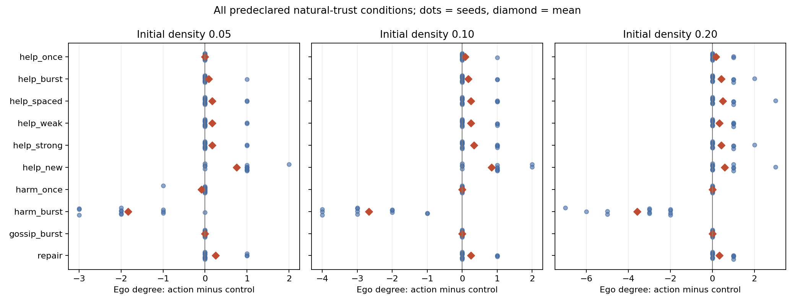
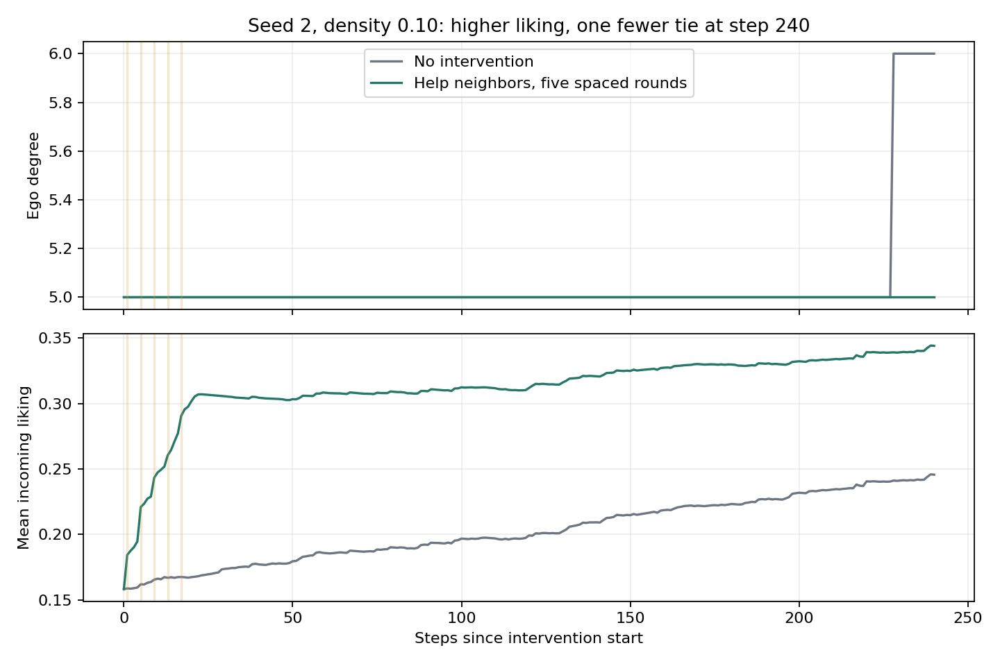

# 初期条件と行動の比較：実験結果と判断の限界

2026年11月7日実施。現行の自律交流モデルを変更せず、**540条件（介入492条件と無操作確認48条件）の対応比較**を実行した。さらに、見つかった逆転例について480ステップまでの追加確認を1件実施した。結論は「協力すれば必ず関係が増える」でも「攻撃すれば必ず即座に切れる」でもない。評判・信頼・関係数は異なる動きを示し、観測期間によって評価も変わる。

ただし、これは人間の行動の実証実験ではない。以下の「選ぶべき行動」は、このソフトウェアの仮定の下で目的に近づくための判断であり、現実の対人関係への効果を保証するものではない。

## 実験の範囲

40人、12シード、初期密度0.05／0.10／0.20。10ステップの準備後に人物1を操作し、11方針を60ステップ比較した396条件、既存関係の信頼を低く／高く人工設定した96条件、240ステップの長期比較48条件。540条件は独立な540標本ではなく、同じ12シードを使った対応のある比較である。

協力・攻撃は全接続者、または特定の1人へ行う。噂は知人のうち関係数最大の人物について、他の接続者に伝える。全員向けの相手は各操作時に決め、1人向けの相手は介入直前に固定した。シード0〜5を探索群、100〜105を確認群とし、同じ方針を実行した。

「行動なし」にも自律交流がある。各比較の初期X・A・信頼・属性・時間残量を一致させ、用途別のキー付き乱数を共通にした。対照世界が行動方針によって変わらないことも検査した。全試行の終了状態は観測期間内の `not_converged` であり、以下の「最終」は**指定した観測終了時点**を指す。

現在の初期好感度は非関係者N(0,0.35²)、既存関係は[0.65,0.90]。SRMのactor／partner分解は実装されていない。関係はER型無向グラフ、コミュニティはAからCPM＋Leidenで検出する。詳細は[実験手順](experiments/conditions-and-policies/protocol.md)を参照。

## 60ステップ時点：何が変わったか

表は自然な初期信頼の36条件（12シード×3密度）。Δは同じ初期状態の行動なしとの差。好感度・信頼は自己を除く39人からの平均で、非関係者も含む。

| 方針 | 本人の関係数・平均Δ | 関係数が増／同／減 | 受信好感度・平均Δ | 受信信頼・平均Δ |
| --- | ---: | --- | ---: | ---: |
| 全員へ協力1回 | +0.08 | 3／33／0 | +0.041 | +0.0028 |
| 全員へ協力5連続 | +0.22 | 7／29／0 | +0.179 | +0.0069 |
| 全員へ協力5回、間隔4 | +0.31 | 9／27／0 | +0.186 | +0.0072 |
| 切断閾値に最も近い知人1人へ協力5回 | +0.25 | 9／27／0 | +0.176 | +0.0048 |
| 自分への信頼が最も高い知人1人へ協力5回 | +0.31 | 10／26／0 | +0.172 | +0.0045 |
| 成立条件に最も近い未接続者1人へ協力5回 | +0.72 | 21／15／0 | +0.186 | +0.0165 |
| 全員へ攻撃1回 | −0.03 | 0／35／1 | −0.040 | −0.0047 |
| 全員へ攻撃5連続 | −2.69 | 0／1／35 | −0.201 | −0.0257 |
| 悪い噂5連続 | 0.00 | 0／36／0 | −0.003 | −0.0049 |
| 攻撃1回、その後に協力4回 | +0.28 | 10／26／0 | +0.123 | +0.0022 |

関係数の改善だけでは「周りと上手くいった」と判定しない。例えば、全員への協力5連続でも、8／36条件では受信信頼が対照より低かった。全員への協力1回・間隔を空けた協力でも、それぞれ10／36・9／36条件で信頼が下回る。直接の協力は信頼を増やす式だが、他の交流や相手選択が変わった後の最終値はそれだけでは決まらない。

### コミュニティ構造は変わったか

同じ36条件のCPM＋Leidenによる観測結果。主要コミュニティは3人以上。VIは分割の違いを測り、0なら同じ分割である。

| 方針 | 主要コミュニティ数の平均Δ | コミュニティ数が違う条件 | 分割が違う条件 | 平均VI（bits） |
| --- | ---: | ---: | ---: | ---: |
| 全員へ協力5回、間隔4 | −0.06 | 8／36 | 10／36 | 0.277 |
| 未接続者1人へ協力5回 | −0.06 | 11／36 | 14／36 | 0.331 |
| 全員へ攻撃5連続 | +0.14 | 20／36 | 32／36 | 0.776 |
| 悪い噂5連続 | +0.08 | 3／36 | 4／36 | 0.088 |

**コミュニティの数がほとんど変わらなくても、誰と誰が同じ集団に分類されるかは変わる。** 特に反復攻撃では、集団数の平均差は小さいが分割差は多かった。ただし反復攻撃の11／36条件では最終分割に曖昧な所属者が含まれる。これは構造的分割の比較であり、32件の確定した社会的分裂を意味しない。人数だけの変化ではなく、辺の履歴と検出の不確実性を合わせて読む必要がある。

## どの初期条件で違いが出たか

| 初期関係密度 | 全員へ協力5回・間隔4：本人の関係数Δ | 未接続者へ協力5回：本人の関係数Δ | 全員へ攻撃5連続：本人の関係数Δ |
| --- | ---: | ---: | ---: |
| 0.05 | +0.17 | +0.75 | −1.83 |
| 0.10 | +0.25 | +0.83 | −2.67 |
| 0.20 | +0.50 | +0.58 | −3.58 |

**疎な／中程度の社会で関係を広げたい場合は、既存の友人全員への協力より、双方の成立条件に近い未接続者を選ぶ方針が有望だった。** この方針で関係が増えた条件は探索群8／18、確認群13／18。特定のシードだけで生じた利得ではないが、常に成立するわけではない。相手の選択・1人当たりの強度・目撃や伝播経路が同時に変わるため、差を「選び方」だけの純粋な因果効果とは呼べない。

密な社会では全員への協力と未接続者への協力の差が小さくなった。攻撃5連続による本人の関係損失は密な社会で大きい。全員向けの直接強度は人数で薄まる一方、周辺の観察・伝播・評価更新もある。ただし、密度を変えた比較は本人の次数以外も変わるため、「ハブだから損失が増えた」とは断定できない。

切断閾値に最も近い知人を優先するか、高信頼の知人を優先するかについて、全ての指標で一貫して勝つ方針は確認できなかった。「弱い関係」もこの実験では切断余裕の相対順位であり、社会学的な弱い紐帯そのものを測ったものではない。

### 信頼の高低による違い

密度0.10の同じX／Aから、介入直前の既存関係の信頼だけを両世界とも0.15／0.85へ設定した。各セル12シードの平均。信頼の設定後は、その信頼に応じて自律交流も変わる。

| 初期信頼の統制条件 | 攻撃1回：本人の関係数Δ | 攻撃5連続：本人の関係数Δ | 悪い噂5連続：噂対象の受信好感度Δ | 噂の平均到達人数 |
| --- | ---: | ---: | ---: | ---: |
| 既存関係を低信頼0.15 | 0.00 | −3.17 | −0.0410 | 36.0 |
| 既存関係を高信頼0.85 | 0.00 | −1.92 | −0.1723 | 36.0 |

**信頼の高い集団は反復攻撃による関係損失が小さい一方、同じ程度に広まった悪い噂で評判がより大きく下がった。** 信頼は単に関係を守るだけの変数ではなく、このモデルでは情報の信用度にも使われる。ただしこの二面性の方向は、信頼による攻撃緩衝と噂の信用度を別々の式に組み込んだ結果でもある。実測に基づく新発見とは呼ばない。全ての既存関係を同時に設定した比較であり、1人の信頼だけを変えた実験ではない。

## 非自明な結果は出たか

**条件依存の逆転は出た。ただし、普遍的な逆転法則や、大規模な集団分裂を説明する発見は得ていない。**

1. **好かれていても、新しい関係の獲得が遅れる例。** seed2、密度0.10、全員へ間隔を空けた協力5回では、240ステップ時点で好感度差+0.0985、信頼差+0.00127なのに、本人の関係数は5対6で対照より1本少なかった。初期の知人5人は全員維持している。対照だけが人物18との関係を獲得したためで、「協力して元の友人を失った」結果ではない。
2. **その逆転も観測期間に依存した。** 同じ例を追加で480ステップまで追うと、本人の関係数は10対9、好感度差+0.0692となり、協力側が有利に転じた。480ステップ確認は逆転発見後の診断的な追加実験であり、事前固定した540条件には含めない。240時点の関係数の不利は、協力2方針×12シードの24条件中1条件だけで、確認群では再現しなかった。
3. **本人の関係数増と社会全体の関係数減が同時に起こる。** 240ステップ比較では協力2方針の24条件中3条件。例えばseed2の協力5連続は本人の関係数+1でも、全体の関係数は−1。本人の利得を全体の改善と同一視できない。
4. **噂が全員に届いても、関係線が変わらない。** 密度0.20では12条件全てで発信者以外の39人が噂を知ったが、11／12条件では対照との異なる辺数が0。全密度では29／36条件で辺の違いが0だった。到達と評判更新と切断閾値の超過は別である。seed0・密度0.20では39人に届き、対象の受信好感度は対照より約0.066下がったが、関係線は変わらなかった。

逆転例の履歴では、絶対時刻19の人物1→18の同じ招待が、対照で受諾、協力側では時間不足だった。協力の実行に時間を使うことが、通常の交流機会を変えた具体例である。ただし、最終的な差をこの1回だけのせいとする因果分解はしていない。後続の相手選択・信頼・交流・接触の連鎖を含む総効果である。[全状態と履歴](experiments/conditions-and-policies/cases/s2_d0.1_help_spaced_t240.json.gz)、[読みやすい要約](experiments/conditions-and-policies/cases/s2_d0.1_help_spaced_t240-summary.json)、[480時点の追加確認](experiments/conditions-and-policies/cases/s2_longer_horizon_check.json)を保存した。

単発攻撃の緩衝、反復攻撃による悪化、1人当たり強度の希薄化、噂の信用による割引は、元から更新式に与えた仕組みでもある。これらが出たこと自体を新たな社会法則の発見とは扱わない。

## このモデル内での行動の選び方

| 関係・目的 | 今回の結果から選べる方針 | 留保 |
| --- | --- | --- |
| 今の関係を良好に保ちたい | 攻撃を繰り返さず、協力後の好感度と信頼を両方確認する | 直接効果がプラスでも、別の交流機会を減らすことがある |
| 関係を増やしたい | 相互の成立条件に近い未接続者への協力を試す | 片側だけの好意では成立しない。知人全員へ協力しても新しい相手への本人の好意は自動で上がらない |
| 交流相手が多い | 全員に配る場合の1人当たり量と、特定相手への集中を比べる | 親しい1人を優先するか切れやすい1人を優先するかの万能解はない |
| 連続して働きかけている | 連続／間隔を空ける両方の結果を確認する | 60時点の平均は間隔ありにやや有利だが、240時点では平均関係数差が連続+0.75、間隔あり+0.67。間隔を空ければ必ず良いとはいえない |
| 攻撃してしまった後 | 攻撃を止めて協力に切り替える方針は比較上有効だった | 4回の協力と無攻撃の条件を揃えた純粋な修復効果の検証ではない。切れた相手は全員向け操作の対象から外れる |
| 悪い噂で自分の立場を良くしたい | 今回の結果は、その方針を支持しない | 60時点では本人の関係数は36条件全てで対照と同じ。発信者への反感・嘘の発覚・訂正の仕組みが未実装なので、現実の利害判断には不十分 |

1人だけに働きかける方針はPython APIで検証した。現在の画面の人物1向けボタンは全接続者向けであり、そのボタンだけで全ての比較方針を再現できるわけではない。

## 先行研究と、今回分かったことの区別

- **Sutcliffe, Wang & Dunbar（2012）**：交流履歴・信頼・時間制約と、少数の強い関係を重視するか多数の弱い関係を重視するかを扱う。本実験の集中／分散比較の動機になる。ただし、今回の時間上限1・信頼学習率0.18・攻撃緩衝式は独自の仮設定で、論文の再現ではない。本文§§2.2–2.5を確認した。https://www.jasss.org/15/4/3.html
- **Rand, Arbesman & Christakis（2011）**：人を対象とした実験で、関係の更新を頻繁に許す条件が協力を支えることを示した。今回の「相手や関係を更新できること」の比較に関連する。ただし、原研究の非協力は一般的な「攻撃」と同じ概念ではなく、今回の好感度閾値も原研究の実測値ではない。原研究は関係の維持・成立・切断に明示的な費用や次数上限を設けておらず、今回の時間制約をこの研究で正当化しない。本文pp.19193–19196を確認した。https://doi.org/10.1073/pnas.1108243108
- **Dores Cruz et al.（2021）**：日常生活の噂と対象の評判更新、将来の援助・回避意図の関連を観測した。到達・評価・相手選択を分ける必要性に関係する。送信者と対象の利害対立は真実らしさの低さと関連した一方、この研究では情報源数や同じ噂を聞いた回数は真実らしさを予測しなかった。したがって今回の別event_idによる反復加算を、人間で確認された反復効果とは扱えない。本文§3(b)、§4を確認した。https://doi.org/10.1098/rstb.2020.0301

## 限界と、次に確かめること

好感度・信頼は合成変数で、上の数値は実測から校正していない。行動の評価は単純な式で決まり、謝罪の内容・行動の動機・公正さ・嘘・心理的所属はない。自律交流も確率的な相手選択と受諾であり、人間の意思決定の検証済みモデルではない。ここから現実の「こうすれば必ず上手くいく」は導けない。

今回の自然条件の人物1は介入前に1〜10本の関係を持っていた。人物1が完全に孤立している条件、他の行動者、30／50人、別の初期好感度分布、別の閾値・予算・目撃者数、集団検出解像度の感度は、この研究では網羅していない。コミュニティ数やVIは全条件で保存しているが、分裂・合流の頑健性を別解像度・帰無グラフまで検証したものではない。

「面白い結果」を増やすために分裂や報復を強制してはいない。次の研究としては、同じ総効果・同じ目撃機会で相手選択だけを変える統制、交流予算の機構を分離した比較、反復する噂のclaim_idによる同一主張の識別、発信者評価の更新と訂正を、それぞれ独立に検証することが有益である。後二者の具体的な更新式は新たな独自仮定を要する。

## データ・検証

[全条件表](experiments/conditions-and-policies/all-conditions.md)、[全試行CSV](experiments/conditions-and-policies/runs.csv)、[シード単位の区間推定](experiments/conditions-and-policies/estimates.json)、[方針同士の対応比較](experiments/conditions-and-policies/pairwise.json)、[長期全条件表](experiments/conditions-and-policies/long-horizon/all-conditions.md)、[実験手順と再実行コマンド](experiments/conditions-and-policies/protocol.md)。

検査したのは、全試行の初期ペア一致、無操作での両世界一致、方針によらない対照世界、別実行での全指標・状態ダイジェストの完全再現。実験手順用の3テストを追加し、既存41件と合わせて44件通過した。今回の数値実験はPython単独で実行し、TouchDesignerで540条件をボタン操作したという意味ではない。アプリの更新式と正式 `.toe` は変更していない。
