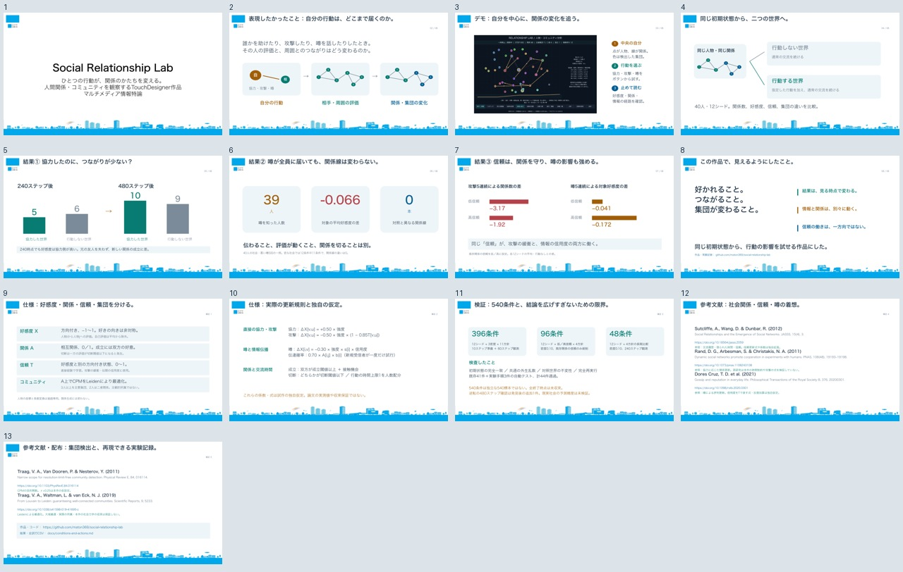

# 5分の作品発表

- [発表用PDF](Social_Relationship_Lab.pdf)：フォントを埋め込んだ13枚。講義では**1〜8枚で終了**し、9〜13枚は質問があった場合の補足に使う。
- [編集用PowerPoint](Social_Relationship_Lab.pptx)：文字・図形・棒グラフを編集可能。各ページに発表者ノート付き。
- [読み上げ原稿・時間配分・デモ操作](speaker-notes.md)：本編合計300秒。デモ操作時間を含む。



| 本編 | 内容 | 時間 | 累計 |
| --- | --- | ---: | ---: |
| 1 | 作品紹介 | 15秒 | 0:15 |
| 2 | 作品で表現したかったこと | 35秒 | 0:50 |
| 3 | デモ画面・操作 | 50秒 | 1:40 |
| 4 | 同じ初期状態からの比較 | 25秒 | 2:05 |
| 5 | 結果①：協力の評価が時間で逆転 | 65秒 | 3:10 |
| 6 | 結果②：噂が届いても関係線は同じ | 50秒 | 4:00 |
| 7 | 結果③：信頼の二面性 | 40秒 | 4:40 |
| 8 | 作品のまとめ | 20秒 | 5:00 |

## 発表前の準備

1. `Social_Relationship_Lab.toe` を開き、人物1を中心にした状態で一時停止する。
2. スライド3で作品へ切り替え、全員に協力→1ステップ→詳細を確認する。余裕があれば、初期状態へ戻して噂の伝播も見せる。
3. 操作が不調ならスライド3の実画面で説明を続ける。後の結果図は保存された数値実験であり、その場のデモで同じ結果を出す必要はない。
4. 8枚目で本編を終える。仕様・式・検証の範囲・先行研究の引用は9枚目以降にまとめてある。

ノートは約1,430字。300秒の割り当てには画面の切り替えと操作を含む。実際の話す速さで一度通し、スライド5の説明に時間を残す。

## データと表現

- デモ写真は[実際のTouchDesigner画面](../docs/screenshots/official.jpg)。結果の代表例と同一の実験画面ではない。
- グラフの数値は[実験記録](../docs/experiments/conditions-and-policies/)から読み込んで作成。結果を演出する補正はしていない。
- 240ステップの協力の不利は、協力2方針×12シードの24条件中1例。480ステップは、その例を見つけた後の追加確認。一般的に協力が悪いという主張には使わない。
- 39人への噂の到達は発信者を除く受信者の和集合。関係線0本は、行動なしとの異なる辺数である。
- 信頼の比較は、全ての既存関係の信頼を低／高に人工設定した条件。人間で観測された効果量ではない。
- 文献のDOIと、原研究の概念／独自の式・係数の区別はスライド12〜13と発表者ノートに記載。

## 再生成と表示確認

`build_slides.py` はpython-pptxとPillowで編集用PPTX・ノートを作る。`render_slides.py` は同じPPTXの位置・図形・テキストからSVGを作り、librsvg／PangoとPopplerでPDFを生成する。ブラウザは使用しない。

```sh
python build_slides.py
python render_slides.py
```

PDFは文字を選択可能。13ページ、日本語テキスト抽出、全体プレビュー、テキスト高さの警告0件を確認した。この環境のKeynoteは、最小の試験用PowerPointでも取り込みがタイムアウトしたため、PowerPointのKeynote取り込み結果を表示確認済みとは扱わない。編集用PPTXの構造とノートを検査し、発表用PDFは別のレンダラーで表示確認している。

ローカルではKeynote版も、確認済みの1920×1080画像を各ページに置いて作成した。13枚とノートを確認し、Keynote自身のPDF書き出しでもページ数と表示を確認した。ただし、保存後ファイルの開き直しは、この環境の読み込み処理がタイムアウトして未確認のため、GitHubで配布する形式はPDF／PPTXとしている。講義で確実に表示する用途には、確認済みのPDFを推奨する。

再生成コードはMacの日本語フォントパスを使用する。配布するPDF／PPTXの閲覧にPython環境は不要。
